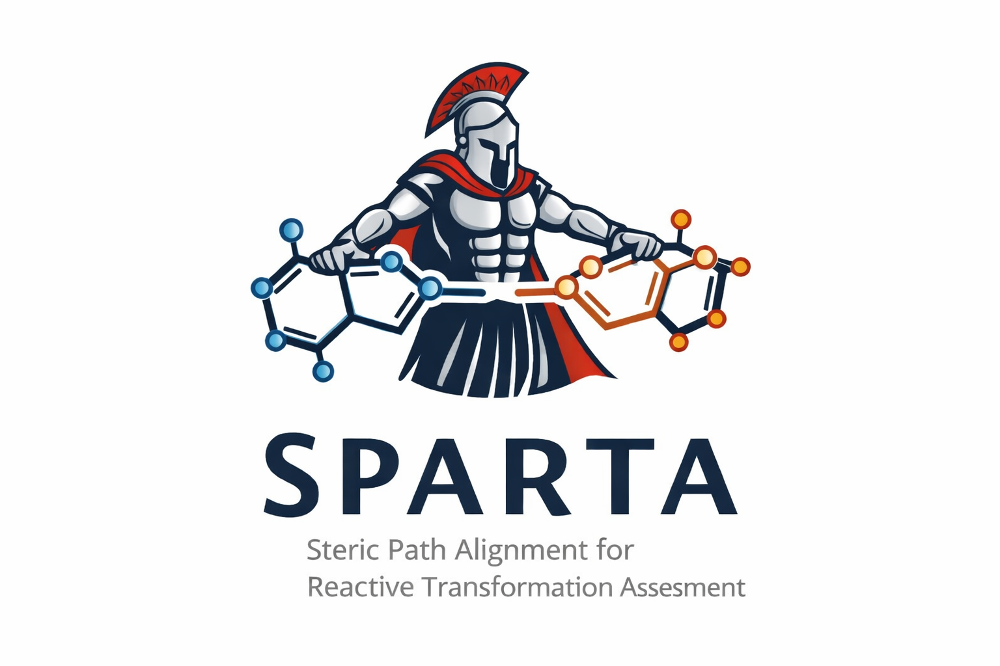

<p align="center">
  
</p>

# SPARTA

**S**teric **P**ath **A**lignment for **R**eactive **T**ransformation **A**ssessment

SPARTA generates reactant–product conformer pairs and iteratively aligns them using an Image-Dependent Pair Potential (IDPP) nudged-elastic-band (NEB) path optimisation. The resulting IDPP barrier score provides a fast, geometry-based proxy for kinetic feasibility — reactions with lower scores have less steric clash along the path connecting reactant and product.

---

## Installation

### Default (pip)

```bash
pip install sparta
```

> SPARTA will be available on PyPI. Until then, use the development install below.


```bash
git clone https://github.com/your-org/sparta.git
cd sparta
pip install .
```

Or with [uv](https://docs.astral.sh/uv/) for a fully reproducible environment:

```bash
git clone https://github.com/your-org/sparta.git
cd sparta
uv sync
```

#### Requirements

| Package | Minimum version |
|---------|----------------|
| Python  | 3.12           |
| numpy   | 1.24           |
| scipy   | 1.16           |
| rdkit   | 2025.9.1       |
| ase     | 3.26           |

---

## Python API

### Quick start

```python
from sparta import Reaction, generate_initial_conformers, run_iterative_alignment

rxn = Reaction(
    reactant_smiles="[CH4:1].[F:2][F:3]",
    product_smiles="[CH3:1][F:2].[H:4][F:3]",
    n_conformers=10,
    n_seeds=3,
    stretch_factors=[1.3, 1.5, 1.8],
    top_k=5,
)

# Functional style — each function returns the reaction object
rxn = generate_initial_conformers(rxn)
rxn = run_iterative_alignment(rxn)

# Method-chaining style (equivalent)
rxn = Reaction(...).generate_initial_conformers().run_iterative_alignment()
```

### Accessing results

```python
# aligned_results is sorted by score (ascending — lower is better)
best = rxn.aligned_results[0]

print(best["score"])            # float: max interior IDPP energy
print(best["reactant_coords"])  # np.ndarray (n_atoms, 3)
print(best["product_coords"])   # np.ndarray (n_atoms, 3)
print(best["images"])           # list of ase.Atoms — full NEB path
print(best["energies"])         # list of float — per-image IDPP energies
print(best["seed"])             # int
print(best["stretch_factor"])   # float
```

All intermediate conformers are also available:

```python
rxn.all_conformers      # every generated conformer pair, sorted by initial NEB score
rxn.top_k_conformers    # the top-k subset passed to iterative alignment
```

### `Reaction` parameters

| Parameter | Type | Default | Description |
|-----------|------|---------|-------------|
| `reactant_smiles` | `str` | — | Atom-mapped SMILES for the reactant(s) |
| `product_smiles` | `str` | — | Atom-mapped SMILES for the product(s) |
| `n_conformers` | `int` | `10` | Conformers per (seed, stretch_factor) combination |
| `n_seeds` | `int` | `1` | Number of random seeds (0 … n_seeds−1) |
| `stretch_factors` | `float` or `list` | `1.5` | Stretch factor(s) applied to changing bond targets in the bounds matrix |
| `top_k` | `int` | `5` | Number of best initial conformers to carry into iterative alignment |
| `n_images` | `int` | `15` | NEB images (including endpoints) |
| `filter_dihedrals` | `bool` | `True` | Restrict optimisation to dihedrals near the reaction centre |
| `k_nearest_dihedrals` | `int` | `3` | Bond-distance cutoff for dihedral filtering |
| `cutoff` | `float` | `10.0` | Neighbour-pair cutoff (Å) for overlap evaluation |
| `rotation` | `bool` | `True` | Include fragment rotations |
| `translation` | `bool` | auto | Include fragment translations (default: `True` when multiple fragments exist) |
| `catalyst_bias` | `float` | `0.0` | Bias the catalyst toward the reaction centre (0 = off, 1 = tightest leash) |
| `catalyst_atoms` | `list[int]` or `None` | `None` | Atom indices (map number − 1) naming the catalyst; auto-detected when `None` |
| `tether_mode` | `str` | `"center"` | Catalyst tether geometry: `"center"` (head-on) or `"explore"` (sphere-cover poses) |
| `tether_anchor` | `int`, `list[int]`, or `None` | `None` | Explicit catalyst atom(s) to tether, overriding `tether_mode` |
| `diversity_rmsd` | `float` | `0.5` | RMSD (Å) below which selected conformers count as duplicates (0 disables) |
| `selection` | `str` | `"coverage"` | `top_k` selection: `"coverage"` (farthest-point spread) or `"score"` (lowest barrier) |
| `score_cap` | `float` or `None` | `3.0` | Drop pairs scoring worse than this multiple of the best score before selection |
| `stereo_debug` | `bool` | `False` | Print opt-in stereochemistry reference and signed-volume diagnostics |
| `n_workers` | `int` | `1` | Default worker processes for method calls when `n_workers` is not passed explicitly |

### Catalyst tethering and conformer coverage

For catalysed / multi-fragment reactions, SPARTA can bias where a non-reacting
fragment (catalyst, additive) is placed during embedding, and how the final seed
conformers are chosen — important when the conformers seed transition-state searches
and should cover diverse pose geometries rather than only low-barrier ones.

- **Catalyst leash** (`catalyst_bias` > 0): caps the distance between the catalyst
  and the reaction centre, so the catalyst is sampled near the reactive site instead
  of at a random, non-clashing position. Name it with `catalyst_atoms`; the reaction
  centre is then the changing-bond atoms of the reacting molecules.
- **Tether geometry** (`tether_mode`): `"center"` pulls the catalyst head-on;
  `"explore"` covers the catalyst and reaction centre with ~4 Å spheres and samples
  one pose per sphere–sphere pair, for broad approach-angle coverage. Set
  `tether_anchor` to one atom index, or a list of atom indices, to sample explicit
  catalyst contact atoms instead.
- **Coverage selection** (`selection="coverage"`, default): `top_k` is chosen by
  farthest-point (max-min) spread in symmetry-aware RMSD space rather than by lowest
  barrier, so the seeds span diverse geometries. A `score_cap` gate first drops the
  sterically worst pairs (score > `score_cap` × best), and `diversity_rmsd` sets the
  near-duplicate floor where coverage stops.

These default to inert / sensible values, so existing unimolecular workflows are
unaffected (`catalyst_bias=0`, `tether_mode="center"`, coverage falls back to the
best-scoring distinct pairs).

### Stereochemistry

SPARTA stores separate reactant and product stereochemical references and uses
coordinate-level signed-volume checks to keep tetrahedral centers from flipping
during product conformer generation and iterative alignment. Atom maps are used
for coordinate bookkeeping, but stereochemical priority is assigned on
map-stripped molecule copies so reaction map numbers do not affect CIP labels.

For implementation details, debugging guidance, and extension notes for E/Z or
atropisomeric stereochemistry, see [`docs/STEREOCHEMISTRY.md`](docs/STEREOCHEMISTRY.md).

### `run_iterative_alignment` parameters

| Parameter | Default | Description |
|-----------|---------|-------------|
| `neb_fmax` | `0.001` | Force convergence criterion for each inner NEB run |
| `neb_steps` | `200` | Maximum steps per inner NEB run |
| `propagation_threshold` | `0.0001` | Stop when max propagated endpoint force < this value |
| `propagation_step_size` | `2.0` | Initial endpoint adjustment step size (Å) |
| `max_iterations` | `40` | Maximum NEB + propagation iterations per conformer |
| `objective` | `"barrier"` | `"barrier"` minimises the max interior image energy; `"total"` minimises the sum |
| `d_power` | `4` | IDPP distance weighting exponent |
| `verbose` | `False` | Print per-iteration progress |

---

## Batch processing (CLI)

The `workflows/process_reactions_from_file.py` script processes a CSV of reactions and writes a results CSV.

### Input file format

A CSV with at minimum these two columns:

```
reactant_smiles,product_smiles
[CH4:1].[F:2][F:3],[CH3:1][F:2].[H:4][F:3]
[c:1]1[cH:2][cH:3][cH:4][cH:5][cH:6]1.[Br:7][Br:8],[c:1]1[cH:2][cH:3][cH:4][cH:5][c:6]1[Br:7].[H:9][Br:8]
```

Additional columns are preserved in the output. Two optional columns are read
per-reaction when present (they override the global config for that row):

| Column | Description |
|--------|-------------|
| `catalyst_atoms` | Space/semicolon-separated atom indices naming the catalyst, e.g. `7 8 9` |
| `tether_anchor` | One or more catalyst atom indices to tether, e.g. `7` or `7 9 11` (overrides `tether_mode`) |

### Basic usage

```bash
# Defaults
python workflows/process_reactions_from_file.py reactions.csv

# Specify output file
python workflows/process_reactions_from_file.py reactions.csv -o results.csv

# Override hyperparameters via flags
python workflows/process_reactions_from_file.py reactions.csv \
    --n-conformers 10 --n-seeds 3 \
    --stretch-factors 1.3 1.5 1.8 \
    --top-k 5 --objective barrier

# Catalysed run: bias the catalyst to the reaction centre, explore poses,
# and pick a coverage-diverse seed set
python workflows/process_reactions_from_file.py reactions.csv \
    --catalyst-bias 0.4 --tether-mode explore \
    --selection coverage --score-cap 3

# Load hyperparameters from a JSON config
python workflows/process_reactions_from_file.py reactions.csv --config config.json

# Save the best aligned conformer pair as XYZ files
python workflows/process_reactions_from_file.py reactions.csv \
    --save-conformers --conformer-dir ./conformers
```

### Config file format

CLI flags override config file values. All keys are optional.

```json
{
    "n_conformers": 10,
    "n_seeds": 3,
    "stretch_factors": [1.3, 1.5, 1.8],
    "top_k": 5,
    "n_images": 15,
    "catalyst_bias": 0.0,
    "tether_mode": "center",
    "diversity_rmsd": 0.5,
    "selection": "coverage",
    "score_cap": 3.0,
    "neb_fmax": 0.001,
    "neb_steps": 200,
    "propagation_threshold": 0.0001,
    "propagation_step_size": 2.0,
    "max_iterations": 40,
    "objective": "barrier",
    "d_power": 4
}
```

### Output

The output CSV contains all original columns plus:

| Column | Description |
|--------|-------------|
| `status` | `ok`, `no_results`, or `error: <message>` |
| `best_score` | IDPP score of the best aligned conformer (lower = better) |
| `all_scores` | Semicolon-separated scores for all aligned conformers |

### All CLI flags

```
positional arguments:
  input                       CSV file with reactant_smiles and product_smiles columns

options:
  -o, --output FILE           Output CSV (default: <input>_results.csv)
  -c, --config FILE           JSON config file for hyperparameters

  --n-conformers INT          Conformers per (seed, stretch_factor) [default: 10]
  --n-seeds INT               Number of random seeds [default: 1]
  --stretch-factors SF [...]  Stretch factor(s) [default: 1.5]
  --top-k INT                 Top-k conformers to align [default: 5]
  --n-images INT              NEB images [default: 15]

  --catalyst-bias FLOAT       Bias catalyst toward the reaction centre, 0–1 [default: 0.0]
  --tether-mode {center,explore}  Catalyst tether geometry [default: center]
  --diversity-rmsd FLOAT      Duplicate RMSD floor Å [default: 0.5]
  --selection {coverage,score}    top_k selection strategy [default: coverage]
  --score-cap FLOAT           Drop pairs > this × best score before selection [default: 3.0]
  --no-score-cap              Disable the score-cap feasibility gate

  --neb-fmax FLOAT            NEB force convergence [default: 0.001]
  --neb-steps INT             Max NEB steps per run [default: 200]
  --propagation-threshold F   Endpoint force convergence [default: 0.0001]
  --propagation-step-size F   Initial endpoint step size Å [default: 2.0]
  --max-iterations INT        Max NEB+propagation iterations [default: 40]
  --objective {barrier,total} Optimisation objective [default: barrier]
  --d-power INT               IDPP distance exponent [default: 4]

  --save-conformers           Save best XYZ conformer pair per reaction
  --conformer-dir DIR         Directory for XYZ files [default: conformers]
  --verbose                   Print per-conformer optimisation progress
```
